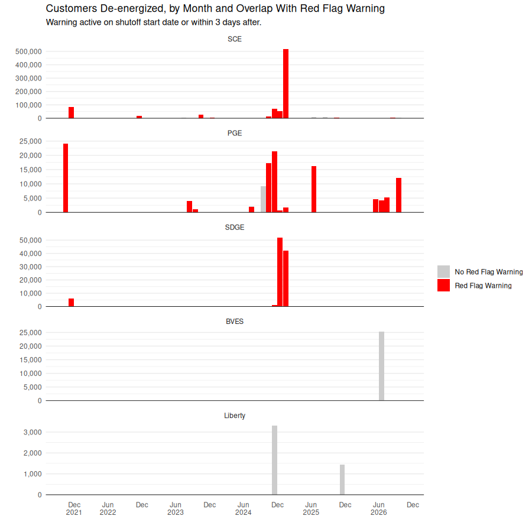

# **Analysis of Public Safety Power Shutoffs in California**

[R](https://www.r-project.org/) code to reproduce the analysis of Public Safety Power Shutoffs (PSPS) referenced in [this Nov. 16, 2026, Inside Climate News article](https://insideclimatenews.org/news/16112026/wildfire-legal-actions-against-utilities/). These shutoffs are implemented under conditions in which sparking from power lines is likely to ignite wildfires.

### **Methodology/code/data**

The repository contains the script `ca_psps.R`. This analyzes [data](https://echo.epa.gov/tools/data-downloads#ECM) behind the California Public California Public Utilities Commission's [Public Power Safety Shutoff Dashboard](https://www.arcgis.com/apps/dashboards/ecd21b1c204f47da8b1fcc4c5c3b7d3a#), which documents shutoffs since January 2018. From October 2021, the data includes mapped polygons showing the area affected. To relate these shutoffs to fire risk, we considered their overlap in time and space with Red Flag warnings issued by the National Weather Service, corresponding to strong winds, low humidity and dry fuels, archived by the [Iowa Environmental Mesonet](https://mesonet.agron.iastate.edu/request/gis/watchwarn.phtml).

### Results

Between January 2018 and the end of October 2026, there have been **128** PSPS events affecting **4.56 million** customers. (Note, if a customer has been cut off on more than one occasion, they will be counted once for each event.)

The breakdown by utility:

| Utility | Number of PSPS events | Customers de-energized |
|----|----|----|
| Pacific Gas & Electricity (PGE) | 35 | 2,904,225 |
| Southern California Edison (SCE) | 67 | 1,346,860 |
| San Diego Gas & Electricity (SDGE) | 17 | 250,907 |
| Bear Valley Electric Service (BVES) | 2 | 49,954 |
| Liberty Utilities | 5 | 4,740 |
| PacifiCorp | 2 | 4,512 |

Since October 2021, there have been **73** PSPS events affecting **1.08 million** customers. For **93 percent** of the customers that had their power cut, a Red Flag fire warning overlapping with the affected area was issued within three days of the shutoff.

Shutoffs that were not followed within three days by Red Flag warning generally affected relatively small numbers of customers.

This chart shows the monthly timeline of shut-offs, their overlap with Red Flag warnings by utility and the number of customers de-energized:

### **Questions/Feedback**

Email [Peter Aldhous](mailto:peter.aldhous@insideclimatenews.org).
